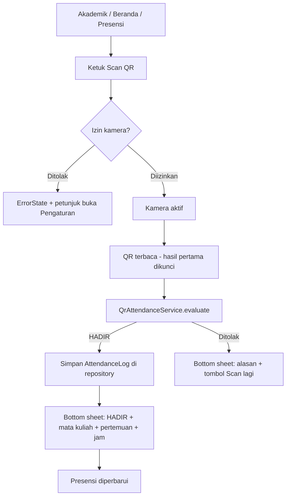

# QR_ATTENDANCE.md — Pedoman Fitur QR Attendance (Boash Student App)

> **Status:** Fase 2 diimplementasikan; uji kamera pada perangkat sungguhan masih menunggu.
> **Tanggal audit:** 2026-10-30 · **Commit yang diaudit:** `b980ad6 update sistem`
> **Sumber:** Modul *Pertemuan 6 — Aplikasi QR Code Attendance Menggunakan Flutter*
> (Teknik Rekayasa Multimedia) + audit repository `Boash-Application-System`.
>
> Dokumen ini adalah **acuan tunggal** untuk membangun fitur *QR Attendance*
> di BAS: apa yang diajarkan modul, kondisi repo saat ini, bagaimana keduanya
> disambungkan, dan langkah kerja yang boleh/tidak boleh dilakukan.
> Dokumen ini ditulis agar bisa dipakai manusia maupun AI agent
> (lihat bagian 11, *Aturan wajib*).

---

## 1. Ringkasan

**QR Attendance** = mahasiswa membuka kamera di aplikasi, memindai QR Code yang
ditampilkan dosen saat kuliah, lalu aplikasi memvalidasi isinya dan menampilkan
status **HADIR** (atau alasan penolakan).

Di modul, fitur ini dibuat sebagai aplikasi Flutter kecil yang berdiri sendiri
dan **tanpa database**. Di BAS, fitur ini harus **menempel pada aplikasi yang
sudah ada**: memakai sesi login (NPM), data mata kuliah & jadwal, pola state
`AsyncController`, design system, dan halaman **Presensi** yang sudah ada.

| Item | Keputusan |
| --- | --- |
| Letak menu | **Akademik → Presensi → tombol "Scan QR"** + pintasan "Scan QR" di grid Akademik dan Akses Cepat Beranda. **Bukan** tab bottom-navigation baru. |
| Package | `mobile_scanner` (sesuai modul, `^7.1.2`) |
| Identitas mahasiswa | `AppController.session.npm` — bukan hard-code |
| Penyimpanan | Fase 1–2: **memori aplikasi** (hilang saat app ditutup), berlabel **Demo**. Fase 3: backend. |
| Kejujuran UI | Selama belum ada backend, UI **tidak boleh** mengklaim presensi tercatat resmi. |

---

## 2. Isi modul Pertemuan 6 (yang dipahami)

**Tujuan modul:** memahami konsep QR Attendance, mengakses kamera Android,
memindai QR, memvalidasi hasil scan, menampilkan status kehadiran, dan membuat
aplikasi absensi QR **tanpa database**.

**Studi kasus:** dosen menampilkan QR saat kuliah; mahasiswa memindai dengan
aplikasi Flutter dan mendapat status HADIR.

**Yang diajarkan modul:**

1. `flutter create qr_attendance`.
2. Struktur: `main.dart`, `pages/{home_page,scanner_page}.dart`,
   `models/attendance_model.dart`, `services/qr_service.dart`.
3. Dependency `mobile_scanner: ^7.1.2`.
4. Izin Android: `<uses-permission android:name="android.permission.CAMERA"/>`.
5. `QrService.validateQr(code)` → `code == "ABSEN-TRM-2026"`.
6. `ScannerPage` memakai widget `MobileScanner(onDetect: ...)`; hasil `HADIR`
   atau `QR TIDAK VALID` ditampilkan lewat `setState`.
7. `HomePage` membuka scanner dengan `Navigator.push()`.
8. Pengujian 3 skenario: QR valid → HADIR; QR lain → QR TIDAK VALID;
   kamera tidak diizinkan → Permission Error.

**Keterbatasan modul (harus diperbaiki saat masuk BAS):**

| # | Keterbatasan di modul | Dampak | Perbaikan di BAS |
| --- | --- | --- | --- |
| M1 | Satu kode statis `ABSEN-TRM-2026` | Siapa pun yang tahu/screenshot kodenya "hadir"; tidak tahu mata kuliah/pertemuan mana | Payload terstruktur (mata kuliah, pertemuan, masa berlaku) — bagian 6.2 |
| M2 | Validasi di-hard-code ulang di `ScannerPage` (duplikat `QrService`) | Dua sumber kebenaran | Semua validasi hanya di service |
| M3 | `capture.barcodes.first` tanpa cek kosong; `rawValue` nullable | Bisa *throw* / null | Guard `isEmpty` dan `rawValue == null` |
| M4 | `onDetect` memanggil `setState` terus-menerus selama QR terlihat | Rebuild berlebihan, hasil bisa "berkedip" | Kunci hasil pertama (`_handled`) + `DetectionSpeed.noDuplicates` |
| M5 | Tidak ada pencatatan (tidak tahu siapa, kapan) | "HADIR" hilang begitu layar ditutup | `AttendanceLog` (NPM, mata kuliah, pertemuan, waktu) |
| M6 | `main.dart` langsung `home: ScannerPage()` | Tidak ada navigasi | Dibuka dari Akademik/Presensi |
| M7 | Skenario izin kamera hanya disebut, tanpa tampilan | Layar kosong bila izin ditolak | `errorBuilder` + `ErrorState` dengan instruksi |
| M8 | Hanya Android | BAS menargetkan web/desktop juga | Fallback "kode manual" + daftar platform di bagian 8 |

---

## 3. Audit repository BAS

### 3.1 Fakta aktual repo

| Aspek | Kondisi di repo |
| --- | --- |
| Nama paket / versi | `bas` · `2.0.0+2` · Dart `^3.13.4` (Flutter 3.47.x menurut README) |
| Dependency | `google_fonts`, `http`, `pdf`, `printing`, `cupertino_icons`. **Tanpa** package kamera/QR. |
| State management | `ChangeNotifier` bawaan: `AppController` (sesi/login), `AsyncController<T>` + `AsyncBuilder<T>` (loading/error/empty/success) |
| Alur root | `main.dart` → `AppRoot` (Splash → `LoginScreen` / `MainShell`) |
| Navigasi | `MainShell`: `BottomNavigationBar` 5 tab (Beranda, Jadwal, Akademik, Pengumuman, Profil) di `IndexedStack`. Sub-halaman dibuka dengan `Navigator.push(MaterialPageRoute)`. |
| Login | NPM (≥5 digit angka) + password (≥4 karakter) — **simulasi**. Sesi = `AppSession.fromNpm(npm)` di memori. Field penting: `session.npm`, `fullName`, `programStudi`. |
| Data | `DemoData` = satu-satunya sumber data demo; `DemoRepository` membungkusnya dengan `latency` dan `simulateFailure`. Satu instance repository dibuat di `_BoashStudentAppState` dan dioper ke semua layar. |
| API eksternal | `NilaiApi` → `mockapi.io/nilai?npm=…`. Server **tidak memfilter dengan benar** → wajib filter client-side. Sudah jadi pola resmi untuk data per-NPM. |
| Mata kuliah | `Course` (`MK-01`…`MK-08`), 8 mata kuliah di `DemoData.courses` |
| Jadwal | `ClassSession` (`courseCode`, `weekday`, `start`, `end`, `room`). **`start`/`end` memakai tanggal acuan Januari 2026** — hanya `weekday` dan jam/menitnya yang bermakna. |
| Presensi sekarang | `AttendanceRecord` (rekap: `totalMeeting`, `attended`, `sick`, `permission`, `missed`; `percentage`). **Read-only**, dari `DemoData.attendance`, ditampilkan `AttendanceScreen` dengan banner `DemoNotice`. Tidak ada data per-pertemuan, tidak ada aksi mencatat. |
| Android | `AndroidManifest.xml` hanya `INTERNET`; `minSdk = flutter.minSdkVersion`. **Belum ada `CAMERA`.** |
| iOS | `IPHONEOS_DEPLOYMENT_TARGET = 15.0`; `Info.plist` **belum** punya `NSCameraUsageDescription`. |
| KTM | Barcode **dekoratif**, sengaja tidak diklaim sebagai alat verifikasi (REVISI §3, README). |
| Pengujian | Test widget/unit di `test/`, memakai `test/support/test_harness.dart` (`fastRepository()`, `createLoggedInController()`, `wrapWithTheme()`). Flutter test **tidak punya kamera** → scanner diganti saat test. |
| Design system | `AppColors` (`success/warning/danger/info`, `iconNavy` untuk semua ikon menu), `AppSpacing`, `StatusBadge`, `DemoNotice`/`DemoNote`, `showAppSnackBar`, `AppCard`, `AppButton`, `ErrorState`, `EmptyState`. Aturan: file < ±300 baris, komponen dipakai >2× pindah ke `lib/widgets/`. |
| Pola AI-agent repo | `PROMPT_OPENCODE.md`: fitur akademik baru **di dalam Akademik**, jangan ubah desain lain, jangan mengarang data, jangan klaim sukses palsu. |

### 3.2 Temuan audit yang berhubungan dengan fitur ini

| # | Temuan | Lokasi | Pengaruh ke QR Attendance | Tindakan |
| --- | --- | --- | --- | --- |
| A1 | `AttendanceRecord` const tanpa `copyWith`, dan rekap statis | `lib/models/attendance.dart` | Tidak bisa diperbarui setelah scan | Tambah `copyWith` (bagian 7.3) |
| A2 | Repository tidak punya state tulis; `DemoRepository` hanya "respond" data konstan | `lib/data/demo_repository.dart` | Scan butuh tempat menyimpan log | Tambah daftar log di memori **di repository** (satu instance, bertahan antar layar) |
| A3 | `ClassSession.start/end` bertanggal Jan 2026 | `lib/models/class_session.dart`, `demo_data.dart` | Membandingkan `DateTime.now()` langsung dengan `start` **selalu salah** | Bandingkan hanya `weekday` + jam/menit (bagian 6.3) |
| A4 | Daftar mata kuliah di Akademik **ditulis ulang manual** (record `('MK-01', …)`) dan duplikat `DemoData.courses` | `academic_screen.dart` `_courseCards` | Dua sumber nama/kode mata kuliah → bisa tidak sinkron dengan validasi QR | Validasi QR **hanya** baca `DemoData.courses`. Rapikan A4 sebagai tugas terpisah (opsional) |
| A5 | Akses Cepat Beranda "Presensi" membuka **hub Akademik**, bukan halaman Presensi | `dashboard_screen.dart` (`onTap: _openAcademic`) | Pengguna butuh 2 ketuk ke Presensi | Tambah tile "Scan QR" yang langsung membuka scanner |
| A6 | Grid Akademik 3 kolom berisi 7 menu | `academic_screen.dart` | Menu ke-8 jadi baris ke-3 (2 item) — masih rapi | Aman menambah 1 tile |
| A7 | `lib/services/auth_api.dart` (randomuser.me) **tidak dipakai** di mana pun; login sekarang berbasis NPM lokal | seluruh `lib/` | Tidak berdampak langsung | Jangan dijadikan dasar identitas; pakai `session.npm` |
| A8 | Dokumentasi tertinggal: README/`design.md` masih menyebut login `randomuser.me`, "20 tes", "Akademik 5 menu"; kode sekarang: login NPM, 24 tes, 7 menu | `README.md`, `design.md`, `WORKFLOW.md` | Bisa menyesatkan pembaca fitur baru | Perbarui sekalian saat fitur selesai (bagian 12) |
| A9 | `pubspec.lock` **ter-commit dan tidak diabaikan** oleh `.gitignore` pada working tree ini | repo root | Versi `mobile_scanner` ikut terkunci | Sudah sesuai untuk aplikasi; pertahankan lockfile |
| A10 | `AppSession.demoSemester = '5 (Ganjil)'` dan `DemoData.nim = '20240001'` bersifat contoh | `app_session.dart`, `demo_data.dart` | `DemoData.nim` bukan NPM yang login | Log presensi **wajib** memakai `session.npm`, bukan `DemoData.nim` |

> Audit ini hanya membaca kode; `flutter analyze`/`flutter test` **belum
> dijalankan** untuk dokumen ini. Jalankan keduanya sebelum mulai (bagian 9, langkah 0)
> agar ada baseline.

---

## 4. Pemetaan modul → BAS

| Modul | Di BAS | Catatan |
| --- | --- | --- |
| `lib/pages/home_page.dart` | **Tidak dibuat.** Diganti tombol di `AttendanceScreen` + tile di `AcademicScreen` + tile di Akses Cepat `DashboardScreen` | BAS sudah punya shell & navigasi |
| `lib/pages/scanner_page.dart` | `lib/features/academic/qr_scanner_screen.dart` | Folder `academic/` karena `attendance_screen.dart` ada di sana |
| (hasil scan di body `Column`) | `lib/features/academic/qr_scan_result_sheet.dart` (bottom sheet) | Pola bottom sheet sudah dipakai di `schedule_screen.dart` |
| `lib/models/attendance_model.dart` | `lib/models/attendance_log.dart` + `lib/models/qr_payload.dart`; `attendance.dart` ditambah `copyWith` | `AttendanceRecord` yang sudah ada **dipertahankan** |
| `lib/services/qr_service.dart` | `lib/services/qr_attendance_service.dart` | Murni Dart, tanpa Flutter → mudah diuji |
| `main.dart` `home: ScannerPage()` | **Tidak diubah** | `AppRoot` tetap memegang alur |
| `AndroidManifest.xml` CAMERA | Sama + iOS `NSCameraUsageDescription` | Bagian 8 |

---

## 5. Ruang lingkup bertahap

| Fase | Isi | Backend | Status klaim di UI |
| --- | --- | --- | --- |
| **1 — Paritas modul** | Scanner + validasi satu kode statis; hasil `HADIR` / `QR TIDAK VALID`; error izin kamera | Tidak ada | "Demo — tidak tercatat" |
| **2 — Terintegrasi BAS** *(target utama pedoman ini)* | Payload terstruktur, validasi jadwal & masa berlaku, `AttendanceLog` di memori repository, rekap Presensi ikut berubah, riwayat scan, anti-duplikat, fallback manual (flag demo) | Tidak ada (memori) | "Demo — hilang saat aplikasi ditutup" |
| **3 — Persisten (opsional)** | Kirim/baca log ke `mockapi.io` (resource baru `presensi`) mengikuti pola `NilaiApi`; token QR berotasi | mockapi.io → backend sungguhan | Boleh "tercatat di server demo" hanya bila respons server sukses |

Fase 2 harus selesai penuh (termasuk tes) sebelum Fase 3 dimulai.

---

## 6. Spesifikasi fungsional

### 6.1 Alur pengguna



### 6.2 Format payload QR (Fase 2)

```text
BAS-ATT|<versi>|<kodeMatkul>|<pertemuanKe>|<kedaluwarsaEpochDetik>
contoh: BAS-ATT|1|MK-01|7|1793350800
```

| Field | Aturan |
| --- | --- |
| Prefiks `BAS-ATT` | Wajib persis; selain itu → `formatTidakValid` |
| `versi` | `1`. Versi lain → `formatTidakValid` (ruang untuk evolusi) |
| `kodeMatkul` | Harus ada di `DemoData.courses` (mis. `MK-01`) |
| `pertemuanKe` | Bilangan bulat ≥ 1 |
| `kedaluwarsa` | Epoch **detik** (UTC). Setelah waktu ini → `kedaluwarsa` |

Kode statis modul `ABSEN-TRM-2026` dipertahankan **hanya sebagai mode Fase 1/praktikum**
(konstanta `QrAttendanceService.legacyDemoCode`): hasil `HADIR` tanpa mata kuliah,
**tidak dicatat** ke log. Matikan di Fase 2 bila tidak diperlukan.

> **Batas keamanan yang jujur:** payload di atas **bukan** tanda tangan digital.
> Siapa pun bisa membuat string serupa atau meneruskan screenshot sebelum
> kedaluwarsa. Menyimpan kunci HMAC di dalam aplikasi tidak menambah keamanan
> (kunci bisa diekstrak). Keamanan nyata baru ada di Fase 3: token dibuat &
> diverifikasi **di server**, berumur pendek, terikat sesi kuliah. Sampai saat
> itu fitur wajib berlabel **Demo**.

QR untuk diuji dibuat dari luar aplikasi (generator QR apa pun) dengan string di
atas. BAS **tidak** punya peran dosen/login dosen, jadi **jangan** membuat layar
generator QR dosen palsu di tab utama. (Bila perlu alat uji, buat layar
`debug`-only yang tidak muncul di build rilis.)

### 6.3 Aturan validasi (urutan evaluasi)

| # | Pemeriksaan | Hasil bila gagal (`ScanStatus`) | Pesan UI |
| --- | --- | --- | --- |
| 1 | `rawValue` null/kosong | `formatTidakValid` | "QR tidak berisi data presensi." |
| 2 | Cocok `legacyDemoCode` | (Fase 1: `hadir` tanpa catatan) | "HADIR (mode praktikum, tidak tercatat)" |
| 3 | Parse payload gagal | `formatTidakValid` | "QR TIDAK VALID" |
| 4 | `kodeMatkul` tak ada di mata kuliah mahasiswa | `mataKuliahTidakDikenal` | "Mata kuliah tidak terdaftar pada semester ini." |
| 5 | `now > kedaluwarsa` | `kedaluwarsa` | "QR sudah kedaluwarsa. Minta dosen menampilkan QR baru." |
| 6 | Hari ini bukan hari kuliah mata kuliah itu, atau di luar jendela waktu | `diLuarJadwal` | "Di luar jadwal kuliah mata kuliah ini." |
| 7 | Log `(npm, kodeMatkul, pertemuanKe)` sudah ada | `sudahTercatat` | "Presensi pertemuan ini sudah tercatat." |
| 8 | Lolos semua | `hadir` | "HADIR" |

**Jendela waktu (aturan 6):** hanya `weekday` dan jam/menit dari `ClassSession`
yang dipakai (temuan A3):

```dart
DateTime _onDay(DateTime now, DateTime t) =>
    DateTime(now.year, now.month, now.day, t.hour, t.minute);

bool _inWindow(ClassSession s, DateTime now, Duration early) {
  if (s.weekday != now.weekday) return false;
  final start = _onDay(now, s.start).subtract(early);
  final end = _onDay(now, s.end);
  return !now.isBefore(start) && !now.isAfter(end);
}
```

> `early` (default 15 menit sebelum mulai) dan "boleh sampai jam selesai" adalah
> **asumsi demo yang bisa diubah**, bukan aturan resmi kampus. Jangan menyebutnya
> sebagai kebijakan kampus di UI/dokumen. Terapkan aturan resmi hanya bila
> tersedia. Jadikan parameter konstruktor, bukan angka tersebar.

### 6.4 Status & tampilan hasil

Selalu **teks + ikon + warna** (prinsip `StatusBadge`, tidak hanya warna).

| Status | Badge | Warna token | Ikon |
| --- | --- | --- | --- |
| `hadir` | HADIR | `success` / `successBg` | `check_circle_outline` |
| `sudahTercatat` | SUDAH TERCATAT | `info` / `infoBg` | `info_outline` |
| `kedaluwarsa`, `diLuarJadwal` | DITOLAK | `warning` / `warningBg` | `schedule` |
| `formatTidakValid`, `mataKuliahTidakDikenal` | QR TIDAK VALID | `danger` / `dangerBg` | `error_outline` |

Isi bottom sheet `hadir`: nama mata kuliah, kode, pertemuan ke-N, jam scan
(`DateFormat` dari `lib/core/date_format.dart`), NPM, dan `DemoNotice`
("Presensi demo — disimpan di memori aplikasi, bukan catatan resmi kampus").

### 6.5 Perubahan di layar yang sudah ada

| Layar | Perubahan | Tidak boleh |
| --- | --- | --- |
| `AttendanceScreen` | Tombol **"Scan QR Presensi"** (`AppButton`) di atas daftar; rekap per mata kuliah memasukkan log; bagian baru **"Riwayat scan QR"** (kosong → `EmptyState`) | Mengubah gaya kartu rekap yang ada |
| `AcademicScreen` | Tile baru `MenuIconTile(icon: Icons.qr_code_scanner, label: 'Scan QR')` | Mengubah grid jadi menu lain / menu top-level baru |
| `DashboardScreen` | Tile "Scan QR" di Akses Cepat (langsung buka scanner) | Mengubah ringkasan jadwal/tugas/pengumuman |
| `MainShell` | **Tidak diubah** | Menambah tab |

Ikon tile memakai `iconNavy` (aturan "semua ikon menu satu warna").

---

## 7. Arsitektur & kode referensi

### 7.1 File yang ditambah / diubah

```text
lib/
├── models/
│   ├── attendance.dart           # UBAH: tambah copyWith
│   ├── attendance_log.dart       # BARU
│   └── qr_payload.dart           # BARU (Fase 2)
├── services/
│   └── qr_attendance_service.dart# BARU: parsing + validasi (murni Dart)
├── data/
│   └── demo_repository.dart      # UBAH: log di memori + submitQrScan + fetchAttendanceLogs
├── features/academic/
│   ├── qr_scanner_screen.dart    # BARU
│   ├── qr_scan_result_sheet.dart # BARU
│   ├── attendance_screen.dart    # UBAH: tombol scan + riwayat
│   └── academic_screen.dart      # UBAH: 1 tile
└── features/dashboard/dashboard_screen.dart  # UBAH: 1 tile Akses Cepat
test/
├── qr_attendance_service_test.dart   # BARU (unit, tanpa kamera)
└── qr_attendance_flow_test.dart      # BARU (widget, scanner palsu)
docs/QR_ATTENDANCE.md             # dokumen ini
```

Tidak ada package state-management baru (tetap `ChangeNotifier`).
Tambahan dependency **hanya** `mobile_scanner`.

### 7.2 Model

```dart
// lib/models/attendance_log.dart
/// Satu catatan presensi hasil scan QR (data demo, disimpan di memori).
class AttendanceLog {
  const AttendanceLog({
    required this.npm,
    required this.courseCode,
    required this.courseName,
    required this.meeting,
    required this.scannedAt,
  });

  final String npm;
  final String courseCode;
  final String courseName;
  final int meeting;
  final DateTime scannedAt;
}
```

```dart
// lib/models/qr_payload.dart
class QrPayload {
  const QrPayload({
    required this.courseCode,
    required this.meeting,
    required this.expiresAt,
  });

  final String courseCode;
  final int meeting;
  final DateTime expiresAt;

  static const String prefix = 'BAS-ATT';
  static const String version = '1';

  /// `null` bila format tidak sesuai. Tidak pernah melempar exception.
  static QrPayload? tryParse(String raw) {
    final parts = raw.trim().split('|');
    if (parts.length != 5 || parts[0] != prefix || parts[1] != version) {
      return null;
    }
    final meeting = int.tryParse(parts[3]);
    final exp = int.tryParse(parts[4]);
    if (parts[2].isEmpty || meeting == null || meeting < 1 || exp == null) {
      return null;
    }
    return QrPayload(
      courseCode: parts[2],
      meeting: meeting,
      expiresAt: DateTime.fromMillisecondsSinceEpoch(exp * 1000, isUtc: true),
    );
  }
}
```

### 7.3 `AttendanceRecord.copyWith` (perubahan kecil di model lama)

```dart
AttendanceRecord copyWith({int? totalMeeting, int? attended}) =>
    AttendanceRecord(
      courseCode: courseCode,
      courseName: courseName,
      totalMeeting: totalMeeting ?? this.totalMeeting,
      attended: attended ?? this.attended,
      sick: sick,
      permission: permission,
      missed: missed,
    );
```

**Aturan gabung rekap (asumsi demo):** rekap statis `DemoData.attendance` adalah
data contoh. Setiap log QR dianggap **pertemuan tambahan**:
`totalMeeting += n` dan `attended += n` (n = jumlah log mata kuliah itu).
Dengan begitu persentase tidak pernah >100%. Di Fase 3 aturan ini diganti
rekap dari server. Tulis asumsi ini di komentar kode.

### 7.4 Service (murni Dart, jam bisa disuntik)

```dart
// lib/services/qr_attendance_service.dart
enum ScanStatus {
  hadir,
  sudahTercatat,
  kedaluwarsa,
  diLuarJadwal,
  mataKuliahTidakDikenal,
  formatTidakValid,
}

class ScanResult {
  const ScanResult(this.status, this.message, {this.log});
  final ScanStatus status;
  final String message;
  final AttendanceLog? log;
  bool get isSuccess => status == ScanStatus.hadir;
}

class QrAttendanceService {
  QrAttendanceService({
    DateTime Function()? clock,
    this.earlyWindow = const Duration(minutes: 15),
  }) : _now = clock ?? DateTime.now;

  final DateTime Function() _now;
  final Duration earlyWindow;

  ScanResult evaluate({
    required String? raw,
    required String npm,
    required List<Course> courses,
    required List<ClassSession> schedule,
    required List<AttendanceLog> existing,
  }) {
    if (raw == null || raw.trim().isEmpty) {
      return const ScanResult(
          ScanStatus.formatTidakValid, 'QR tidak berisi data presensi.');
    }
    final payload = QrPayload.tryParse(raw);
    if (payload == null) {
      return const ScanResult(ScanStatus.formatTidakValid, 'QR TIDAK VALID');
    }
    final matches = courses.where((c) => c.code == payload.courseCode);
    if (matches.isEmpty) {
      return const ScanResult(ScanStatus.mataKuliahTidakDikenal,
          'Mata kuliah tidak terdaftar pada semester ini.');
    }
    final course = matches.first;
    final now = _now();
    if (now.toUtc().isAfter(payload.expiresAt)) {
      return const ScanResult(ScanStatus.kedaluwarsa,
          'QR sudah kedaluwarsa. Minta dosen menampilkan QR baru.');
    }
    final inClass = schedule.any((s) =>
        s.courseCode == course.code && _inWindow(s, now, earlyWindow));
    if (!inClass) {
      return const ScanResult(
          ScanStatus.diLuarJadwal, 'Di luar jadwal kuliah mata kuliah ini.');
    }
    final dup = existing.any((l) =>
        l.npm == npm &&
        l.courseCode == course.code &&
        l.meeting == payload.meeting);
    if (dup) {
      return const ScanResult(ScanStatus.sudahTercatat,
          'Presensi pertemuan ini sudah tercatat.');
    }
    return ScanResult(
      ScanStatus.hadir,
      'HADIR',
      log: AttendanceLog(
        npm: npm,
        courseCode: course.code,
        courseName: course.name,
        meeting: payload.meeting,
        scannedAt: now,
      ),
    );
  }

  // _onDay & _inWindow: lihat bagian 6.3
}
```

### 7.5 Repository (satu pintu untuk UI — pola yang sama dengan Fase 3)

```dart
// di DemoRepository
final QrAttendanceService _qrService = QrAttendanceService();
final List<AttendanceLog> _logs = []; // memori; hilang saat app ditutup

/// UI hanya memanggil ini. Di Fase 3 isi method diganti HTTP, signature tetap.
Future<ScanResult> submitQrScan(String? raw, {required String npm}) async {
  final result = _qrService.evaluate(
    raw: raw,
    npm: npm,
    courses: DemoData.courses,
    schedule: DemoData.buildSchedule(),
    existing: _logs,
  );
  if (result.isSuccess) _logs.add(result.log!);
  return _respond(result); // ikut latency & simulateFailure
}

Future<List<AttendanceLog>> fetchAttendanceLogs(String npm) =>
    _respond(_logs.where((l) => l.npm == npm).toList(growable: false));
```

Catatan penting:
- Log **dikunci per `npm`** supaya logout lalu login NPM lain tidak mewarisi log.
- `fetchAttendance()` yang ada tetap mengembalikan rekap statis; penggabungan
  dengan log (bagian 7.3) dilakukan di `AttendanceScreen` atau method baru
  `fetchAttendanceFor(npm)` — pilih satu dan konsisten.
- Jangan menyimpan log di `AsyncController` layar: controller dibuang saat layar
  di-`pop`, repository tidak.

### 7.6 Scanner screen — pola dan perbaikan dari modul

```dart
// lib/features/academic/qr_scanner_screen.dart  (kerangka)
class QrScannerScreen extends StatefulWidget {
  const QrScannerScreen({
    super.key,
    required this.controller,   // AppController (sesi/NPM)
    required this.repository,
    this.scannerBuilder,        // untuk test: ganti kamera dengan widget palsu
  });
  ...
}

class _QrScannerScreenState extends State<QrScannerScreen> {
  final _scanner = MobileScannerController(
    formats: const [BarcodeFormat.qrCode],
    detectionSpeed: DetectionSpeed.noDuplicates,
  );
  bool _handled = false; // perbaikan M4

  Future<void> _onDetect(BarcodeCapture capture) async {
    if (_handled) return;
    if (capture.barcodes.isEmpty) return;           // perbaikan M3
    final raw = capture.barcodes.first.rawValue;
    if (raw == null) return;
    _handled = true;
    await _scanner.stop();
    final npm = widget.controller.session?.npm ?? '';
    final result = await widget.repository.submitQrScan(raw, npm: npm);
    if (!mounted) return;
    await showQrScanResultSheet(context, result);   // bottom sheet
    if (!mounted) return;
    _handled = false;
    await _scanner.start();                         // "Scan lagi"
  }

  @override
  void dispose() {
    _scanner.dispose();
    super.dispose();
  }
  ...
}
```

Wajib:
- Bungkus `submitQrScan` dengan `try/catch` → tampilkan `showAppSnackBar(..., variant: error)`
  bila repository melempar; **jangan** menampilkan HADIR bila submit gagal.
- Tombol submit/scan tidak boleh memicu pemrosesan ganda (`_handled`).
- Tampilkan `DemoNotice` di bawah pratinjau kamera.
- **Izin ditolak / kamera tidak ada:** pakai `errorBuilder` milik `MobileScanner`
  dan tampilkan `ErrorState` dengan teks seperti "Izin kamera ditolak. Aktifkan
  di Pengaturan perangkat." Kode error `MobileScannerErrorCode.permissionDenied`
  → pesan izin; selain itu → pesan umum. *Signature `errorBuilder` berbeda antar
  versi mayor `mobile_scanner` — cek dokumentasi versi yang terpasang dan
  `flutter analyze`.*
- **Fallback kode manual:** tombol "Masukkan kode manual" membuka dialog `TextField`
  yang memanggil jalur validasi yang sama. Kendalikan dengan konstanta
  `const bool kAllowManualQrEntry = true;` (**demo saja**; wajib `false` bila
  dipakai presensi sungguhan karena string QR bisa dikirim ke siapa pun).

---

## 8. Konfigurasi platform

| Platform | Yang perlu dilakukan | Catatan |
| --- | --- | --- |
| **Android** | Tambah `<uses-permission android:name="android.permission.CAMERA"/>` di `android/app/src/main/AndroidManifest.xml` (di samping `INTERNET`) | Jalankan `flutter run` dan cek `minSdk` yang diminta `mobile_scanner` di README paketnya; bila lebih tinggi dari `flutter.minSdkVersion`, set `minSdk` eksplisit di `android/app/build.gradle.kts` |
| **iOS** | Tambah `NSCameraUsageDescription` di `ios/Runner/Info.plist` ("Kamera dipakai untuk memindai QR presensi.") | Deployment target repo 15.0; cek persyaratan versi di README `mobile_scanner` |
| **Web** | Kamera butuh `https://` atau `localhost` | Cek README `mobile_scanner` untuk persyaratan web (skrip tambahan di `web/index.html`) |
| **Windows / Linux** | Anggap **tidak ada kamera/tidak didukung** sampai terbukti | Tampilkan `ErrorState` + fallback kode manual |
| **macOS** | Perlu entitlement kamera di `macos/Runner/*.entitlements` bila diaktifkan | Di luar target utama |

> Tabel ini ditulis dari pengetahuan umum paket dan modul; **belum diverifikasi
> di perangkat**. Verifikasi pada tahap implementasi, jangan diasumsikan.

---

## 9. Panduan implementasi (urutan kerja)

Kerjakan **satu langkah, lalu `flutter analyze` + `flutter test`**.

0. **Baseline:** `flutter pub get && flutter analyze && flutter test`. Catat hasil; test QR parsial yang sudah tersedia memerlukan file service/model sebelum baseline bersih.
1. **Dependency:** `flutter pub add mobile_scanner` (pastikan resolve ke `^7.1.2` atau yang kompatibel dengan Dart `^3.13.4`). Commit `pubspec.yaml` (+ keputusan A9 untuk `pubspec.lock`).
2. **Platform:** izin Android + `Info.plist` iOS (bagian 8).
3. **Model & service (Fase 2 inti):** `attendance_log.dart`, `qr_payload.dart`, `AttendanceRecord.copyWith`, `qr_attendance_service.dart`. Tulis **unit test service dulu** (bagian 10.1) — belum perlu UI.
4. **Repository:** `submitQrScan`, `fetchAttendanceLogs`, gabungan rekap.
5. **Scanner screen + result sheet**, dengan `scannerBuilder` injeksi untuk test.
6. **Integrasi layar:** tombol di `AttendanceScreen`, tile di `AcademicScreen`, tile di `DashboardScreen`. Perubahan visual selain itu **tidak diizinkan**.
7. **Widget test** alur (bagian 10.2).
8. **Uji manual di perangkat Android sungguhan** (3 skenario modul + skenario bagian 10.3).
9. **Dokumentasi:** perbarui file di bagian 12.
10. **Fase 1 saja?** Jika hanya butuh memenuhi tugas praktikum: lewati langkah 3–4, validasi `rawValue == QrAttendanceService.legacyDemoCode`, tampilkan hasil, tanpa log.

---

## 10. Pengujian

### 10.1 Unit test service (tanpa kamera, jam disuntik)

Gunakan `QrAttendanceService(clock: () => DateTime(2026, 11, 2, 8, 30))`
(hari Senin, jam kuliah MK-01 08:00–10:00 di data demo).

| Kasus | Input | Harapan |
| --- | --- | --- |
| Valid | `BAS-ATT\|1\|MK-01\|3\|<epoch 09:30 hari itu>` | `hadir`, `log.courseCode == 'MK-01'`, `log.meeting == 3` |
| Null / kosong | `null`, `''`, `'   '` | `formatTidakValid` |
| Format salah | `hello`, `BAS-ATT\|2\|…`, `BAS-ATT\|1\|MK-01\|0\|…`, `…\|abc` | `formatTidakValid` |
| Matkul asing | `…\|MK-99\|1\|…` | `mataKuliahTidakDikenal` |
| Kedaluwarsa | epoch 1 detik sebelum `now` | `kedaluwarsa` |
| Hari salah | jam diset Selasa 08:30, QR `MK-01` | `diLuarJadwal` |
| Terlalu pagi | Senin 07:30 (di luar `earlyWindow` 15 menit) | `diLuarJadwal` |
| Dalam toleransi | Senin 07:50 | `hadir` |
| Duplikat | log `(npm, MK-01, 3)` sudah ada | `sudahTercatat` |
| NPM lain | log milik NPM berbeda | tidak dianggap duplikat |

### 10.2 Widget test (pakai `test_harness.dart`)

- `QrScannerScreen(scannerBuilder: …)` dengan scanner palsu yang memanggil
  `onDetect` dengan string tertentu → bottom sheet "HADIR" muncul; ulangi
  string yang sama → "SUDAH TERCATAT".
- `AcademicScreen` menampilkan tile `Scan QR` (perbarui test lama yang
  menghitung "tujuh fitur").
- `AttendanceScreen` setelah satu log: bagian "Riwayat scan QR" berisi 1 item,
  persentase rekap berubah sesuai aturan 7.3.
- `fastRepository(simulateFailure: true)` → submit gagal, **tidak** ada tampilan
  HADIR, snackbar error muncul.
- Empty state riwayat saat belum ada scan.

> Karena kamera tidak tersedia di `flutter test`, **jangan** menguji
> `MobileScanner` asli. Itu sebabnya `scannerBuilder` wajib ada.

### 10.3 Uji manual (perangkat sungguhan)

| # | Skenario | Harapan |
| --- | --- | --- |
| 1 | (modul) QR valid | HADIR |
| 2 | (modul) QR lain, mis. URL web | QR TIDAK VALID |
| 3 | (modul) Izin kamera ditolak | `ErrorState` dengan petunjuk, tidak layar kosong |
| 4 | QR dipindai 2× berturut-turut | Kedua: SUDAH TERCATAT, rekap tidak bertambah dua kali |
| 5 | QR kedaluwarsa | DITOLAK + pesan |
| 6 | QR mata kuliah di luar jadwal | DITOLAK + pesan |
| 7 | Logout lalu login NPM berbeda | Riwayat tidak terbawa |
| 8 | Tutup & buka ulang app | Log hilang (sesuai label Demo) |
| 9 | Putar layar / background lalu kembali | Kamera menyala lagi, tidak crash |

---

## 11. Aturan wajib (guardrails)

1. Fitur berada di **dalam Akademik** (+ pintasan Beranda). **Jangan** menambah
   tab bottom-navigation, **jangan** ubah desain/warna/tipografi/layout layar lain.
2. Pakai token `AppColors`, `AppSpacing`, komponen `StatusBadge`, `DemoNotice`,
   `showAppSnackBar`, `AsyncBuilder`/`ErrorState`/`EmptyState`. Jangan buat
   style baru di luar design system.
3. Identitas = `AppController.session.npm`. **Jangan** hard-code NPM, **jangan**
   pakai `DemoData.nim`.
4. **Jangan mengarang** aturan akademik (toleransi terlambat, batas kehadiran,
   minimal hadir). Konstanta demo harus diberi komentar "asumsi demo".
5. **Jangan klaim sukses palsu:** HADIR hanya muncul bila `evaluate` sukses **dan**
   penyimpanan (memori/server) benar-benar selesai.
6. Semua UI Fase 1–2 menampilkan label **Demo**. Jangan menyebut "resmi", "terverifikasi",
   atau "tersimpan di server" sebelum Fase 3 nyata.
7. **Jangan** mengubah barcode dekoratif KTM menjadi QR yang bisa discan tanpa
   keputusan terpisah (REVISI §3: dekoratif kecuali ada mekanisme verifikasi).
8. Log tidak boleh mencetak NPM/payload ke konsol rilis.
9. Jaga file < ±300 baris; pecah `qr_scanner_screen.dart` dan `qr_scan_result_sheet.dart`.
10. Jangan hapus fitur yang berfungsi; test lama yang berubah karena menu baru
    (mis. hitungan menu Akademik) **diperbarui**, bukan dihapus.
11. Laporkan jujur hasil `flutter analyze`/`flutter test` dan apa yang belum diuji di perangkat.

---

## 12. Dokumen yang perlu diperbarui setelah fitur selesai

| Berkas | Perubahan |
| --- | --- |
| `README.md` | Tambah baris fitur "Scan QR Presensi (demo)"; perbarui jumlah tes; **perbaiki bagian Login** (kini NPM, bukan randomuser.me) |
| `design.md` | Peta layar: tambah `QrScannerScreen`; Akademik 8 menu; spesifikasi §4.5 + status/warna hasil scan |
| `WORKFLOW.md` | Tambah alur Scan QR (diagram 6.1) |
| `REVISI.md` | Centang/tambah item "QR Attendance" |
| `docs/IMPLEMENTATION_PLAN.md` | Opsional: catat fase 1–3 |

---

## 13. Risiko & pertanyaan terbuka

| # | Isu | Dampak | Usulan |
| --- | --- | --- | --- |
| R1 | QR bisa di-screenshot & dibagikan | Titip absen | Fase 3: token berumur pendek dari server + verifikasi server; sementara berlabel Demo |
| R2 | Tidak ada peran dosen/generator QR di BAS | Sulit demo end-to-end | Generator QR eksternal untuk uji; layar generator hanya `debug` bila disetujui |
| R3 | Log hanya di memori | Hilang saat app ditutup | Terima untuk Fase 2; Fase 3 `mockapi.io` resource `presensi` + filter client-side per NPM (seperti `NilaiApi`) |
| R4 | Jadwal demo hanya Senin–Jumat dan tanggal acuan 2026 | Uji manual bergantung hari | Test pakai jam disuntik; saat uji manual sesuaikan jadwal demo atau QR |
| R5 | API `mobile_scanner` berubah antar versi mayor | Snippet bisa tidak compile | Pin versi, jalankan `flutter analyze`, ikuti README versi terpasang |
| R6 | Dukungan kamera desktop/web tidak seragam | Layar gagal di platform tertentu | `ErrorState` + fallback manual; target utama Android |
| R7 | Rekap demo + log QR dihitung gabungan (aturan 7.3) | Angka bisa membingungkan | Pertahankan label Demo; ganti dengan rekap server di Fase 3 |

**Perlu keputusan pemilik proyek:**
1. Cukup **Fase 1** (praktikum) atau lanjut **Fase 2**?
2. Pakai `mockapi.io` untuk Fase 3, atau backend lain?
3. Toleransi waktu masuk (`earlyWindow`) — pakai default 15 menit atau aturan kampus yang sebenarnya?
4. Fallback "kode manual" dipertahankan di build akhir atau hanya demo?

---

## 14. Definisi selesai (Fase 2)

- [x] `flutter analyze` bersih, `flutter test` lulus (termasuk test service dan widget QR).
- [x] Dapat dibuka lewat **Akademik → Presensi → Scan QR**, tile **Scan QR** di Akademik, dan Akses Cepat Beranda.
- [ ] 3 skenario modul + skenario 4–9 (bagian 10.3) lulus di perangkat Android sungguhan.
- [x] Izin kamera ditolak dipetakan ke `ErrorState` dengan petunjuk.
- [x] Hasil scan pertama dikunci; tidak ada pemrosesan ganda.
- [x] Log per-NPM; repository tidak mengembalikan log NPM lain.
- [x] Rekap Presensi dan "Riwayat scan QR" memakai sumber log yang sama.
- [x] Semua layar fitur berlabel **Demo**; tidak ada klaim presensi resmi.
- [x] Diff aplikasi tidak mengubah desain layar yang tidak terkait.
- [x] Dokumen bagian 12 diperbarui.

---

## Lampiran A — Kode modul asli (referensi, dipertahankan untuk Fase 1)

```dart
class QrService {
  bool validateQr(String code){
    return code == "ABSEN-TRM-2026";
  }
}
```

Padanan Fase 1 di BAS (tanpa log, tanpa jadwal):

```dart
static const String legacyDemoCode = 'ABSEN-TRM-2026';
bool validateLegacy(String? code) => code == legacyDemoCode;
```

Layar `ScannerPage` modul memakai `Column` → `Expanded(flex: 4, MobileScanner)` +
`Expanded(Center(Text(result)))`. Di BAS, area teks hasil diganti bottom sheet
(6.4) agar kamera tidak tertutup status dan konsisten dengan pola
`schedule_screen.dart`.
